# HustleHub+: Secure Freelance Marketplace (MERN)

HustleHub+ is a full-stack MERN marketplace where **Freelancers** list services (gigs) and **Clients** browse and book them through a simulated payment. Every booking creates a transaction record, each freelancer's income is tracked from those transactions, and that income is turned into an estimated SARS tax bill with a charted breakdown.

The project is containerised, covered by 85 backend and 57 frontend automated tests plus a 123-assertion API security suite, analysed by two independent static analysis tools, and built by a GitHub Actions pipeline that fails on any failing check.

---

## Contents

1. [Features](#features)
2. [Tax estimation: how it works](#tax-estimation-how-it-works)
3. [Getting started](#getting-started)
4. [Architecture](#architecture)
5. [Security implementation](#security-implementation)
6. [Additional security features](#additional-security-features)
7. [Logging and monitoring](#logging-and-monitoring)
8. [Testing](#testing)
9. [Static code analysis](#static-code-analysis)
10. [CI/CD pipeline](#cicd-pipeline)
11. [Docker](#docker)
12. [Security review](#security-review)
13. [Evidence](#evidence)

---

## Features

**Everyone**

* Register and log in as a Client or a Freelancer (JWT authentication)
* Browse and search gigs by keyword and category

**Freelancers**

* Create, update and delete their own gigs
* See bookings received and the transactions behind them
* **Income & tax dashboard:** income for the current tax year charted month by month, an estimated tax bill, take-home pay, effective and marginal rates, a bracket-by-bracket breakdown and the top earning gigs
* Adjust the estimate for deductible business expenses and age group

**Clients**

* Book a gig with a simulated payment
* View their own bookings and transactions

Each booking and its transaction are written together inside a single MongoDB transaction, so a payment record can never exist without its booking, or the reverse.

---

## Tax estimation: how it works

A HustleHub+ freelancer is a **sole proprietor**: gig income is taxed as personal income, not company income. The calculation uses the published SARS individual tax tables for the **2025/2026 year of assessment** and lives in [`api/utils/tax.js`](api/utils/tax.js).

### The tax year

The South African tax year runs from **1 March to the last day of February**. Only transactions inside that window count toward the estimate. All-time income is still shown separately on the dashboard. Boundaries are computed in UTC so they do not drift with the server's timezone.

### The tables

| Taxable income | Rate |
|---|---|
| R0 – R237 100 | 18% of taxable income |
| R237 101 – R370 500 | R42 678 + 26% of the amount above R237 100 |
| R370 501 – R512 800 | R77 362 + 31% of the amount above R370 500 |
| R512 801 – R673 000 | R121 475 + 36% of the amount above R512 800 |
| R673 001 – R857 900 | R179 147 + 39% of the amount above R673 000 |
| R857 901 – R1 817 000 | R251 258 + 41% of the amount above R857 900 |
| R1 817 001 and above | R644 489 + 45% of the amount above R1 817 000 |

Rebates (cumulative by age) and the matching tax thresholds:

| Age | Rebate | Tax threshold |
|---|---|---|
| Under 65 | R17 235 | R95 750 |
| 65 to 74 | R26 679 | R148 217 |
| 75 and over | R29 824 | R165 689 |

### The five steps

1. **Taxable income** = income earned in the tax year − deductible business expenses. Expenses can reduce income to zero but never below it.
2. **Gross tax** = the bracket's fixed base amount + (the bracket rate × income above the bracket's lower edge). The tables are cumulative, so each slice of income is taxed at its own rate. This is *marginal* taxation, not a flat rate applied to the whole amount.
3. **Tax payable** = gross tax − the age rebate, floored at zero. The rebate is a credit against tax owed, never a refund.
4. **Effective rate** = tax payable ÷ taxable income (what is actually paid overall). **Marginal rate** = the rate charged on the next rand earned.
5. **Provisional payments** = tax payable ÷ 2, because sole proprietors pay in two instalments (end of August and end of February).

### Worked example

A freelancer earning **R500 000** in the tax year, under 65, with no expenses:

```
Bracket 1   R0        – R237 100 : R237 100 × 18% = R42 678
Bracket 2   R237 100  – R370 500 : R133 400 × 26% = R34 684
Bracket 3   R370 500  – R500 000 : R129 500 × 31% = R40 145
                                   ─────────────────────────
                        Gross tax                  R117 507
                        Less primary rebate       (R17 235)
                                   ─────────────────────────
                        Tax payable                R100 272

Effective rate  R100 272 / R500 000 = 20.05%
Marginal rate                          31%
Take-home       R500 000 - R100 272 = R399 728
Each provisional payment               R50 136
```

Why **R95 750** is tax free for someone under 65: R95 750 × 18% = R17 235, exactly cancelled by the primary rebate.

### Where it is shown

The **Income & tax** page (`/income`, freelancers only) presents:

* Four summary tilesincome this tax year, estimated tax, estimated take-home, marginal rate
* A **bar chart** of income for each of the twelve months of the tax year
* A **segmented bar** splitting taxable income into take-home pay and tax
* The explanation above, filled in with the freelancer's own figures
* A table of every bracket applied, with the income and tax in each, totalled to the gross tax, the rebate and the amount payable
* The five highest-earning gigs of the tax year

The dashboard (`/dashboard`) carries a condensed version: an estimated tax tile and the monthly income chart.

Both charts are hand-built SVG with no charting dependency. The two series colours were validated for colour-vision-deficiency separation and for contrast against the card surface; identity is never carried by colour alone (every segment is labelled and legended), and each chart offers the same figures as a data table for screen readers.

> The estimate is for planning only. It assumes the freelancer is a South African tax resident with no other income and no VAT registration. It is not a substitute for a tax return.

---

## Getting started

### Option 1: Docker (recommended)

The only prerequisite is Docker Desktop. No MongoDB installation, no certificate generation.

```bash
cp .env.example .env     # then set JWT_SECRET to a long random value
docker compose up --build
```

| Service | URL |
|---|---|
| Web application | <http://localhost:8080> |
| API | <https://localhost:5001> (self-signed certificate) |
| MongoDB | internal to the Docker network only, no published port |

The API generates its own TLS certificate on first start, so no private key is ever baked into an image or committed. Stop the stack with `docker compose down`, or `docker compose down --volumes` to also discard the database.

### Option 2: Running locally

**Prerequisites:** Node.js 20+, a MongoDB database (Atlas or local, with replica set support for transactions), OpenSSL.

```bash
# Backend
cd api
npm install
mkdir -p certs && cd certs
openssl req -nodes -new -x509 -days 365 -subj "/CN=localhost" \
  -keyout server.key -out server.cert
cd ..
cp .env.example .env     # set MONGO_URI and JWT_SECRET
npm run dev              # https://localhost:5001
```

```bash
# Frontend, in a second terminal
cd client
npm install
npm run dev              # http://localhost:5173
```

### Environment variables

| Variable | Required | Default | Purpose |
|---|---|---|---|
| `MONGO_URI` | yes || MongoDB connection string |
| `JWT_SECRET` | yes || Signing key for JSON web tokens |
| `JWT_EXPIRES_IN` | no | `1h` | Token lifetime |
| `PORT` | no | `5001` | API port |
| `CLIENT_ORIGIN` | no | `http://localhost:5173` | The only origin allowed by CORS |
| `TRUST_PROXY` | no || Proxy hops to trust, so per-IP limits stay accurate behind nginx |
| `AUTH_RATE_LIMIT_MAX` | no | `20` | Failed auth attempts per IP per 15 minutes |
| `BOOKING_RATE_LIMIT_MAX` | no | `10` | Bookings per user per 15 minutes |
| `LOCKOUT_MAX_ATTEMPTS` | no | `5` | Failed logins before an account locks |
| `LOCKOUT_MINUTES` | no | `15` | How long an account stays locked |
| `LOG_LEVEL` | no | `info` | Minimum level written to the logs |
| `LOG_DIR` | no | `api/logs` | Where log files are written |
| `LOKI_HOST`, `LOKI_USER`, `LOKI_TOKEN` | no || Grafana Cloud Loki; when all three are set, logs are also shipped there |

The API refuses to start if `JWT_SECRET` or `MONGO_URI` is missing, rather than falling back to an insecure default.

---

## Architecture

```
insy7314-g2-2026-poe-final-group-12/
├─ .github/workflows/      CI pipeline and CodeQL scanning
├─ api/                    Express REST API (HTTPS)
│  ├─ config/              Database connection
│  ├─ controllers/         Request handlers
│  ├─ middleware/          Auth, RBAC, validation, sanitisation, rate limits, errors, logging
│  ├─ models/              Mongoose schemas
│  ├─ routes/              Route definitions
│  ├─ utils/               Logger, constants, tax engine
│  ├─ validators/          express-validator rule sets
│  ├─ tests/               Jest unit + integration suites, Postman collection, reports
│  └─ Dockerfile
├─ client/                 React 19 + Vite single-page app
│  ├─ src/api/             Fetch wrapper
│  ├─ src/components/      Shared UI, including the charts
│  ├─ src/context/         Auth context
│  ├─ src/pages/           Routed pages
│  ├─ src/__tests__/       Vitest suites
│  └─ Dockerfile           Multi-stage build, served by unprivileged nginx
├─ evidence/               Screenshots, logs and analysis results
└─ docker-compose.yml      MongoDB + API + client
```

### API endpoints

| Method | Route | Access | Purpose |
|---|---|---|---|
| `POST` | `/api/auth/register` | public | Create a Client or Freelancer account |
| `POST` | `/api/auth/login` | public | Authenticate, receive a JWT |
| `POST` | `/api/auth/logout` | private | Revoke the current token |
| `GET` | `/api/auth/me` | private | Current user profile |
| `GET` | `/api/gigs` | private | Browse and search gigs |
| `GET` | `/api/gigs/mine` | Freelancer | The caller's own gigs |
| `GET` | `/api/gigs/:id` | private | One gig |
| `POST` | `/api/gigs` | Freelancer | Create a gig |
| `PUT` | `/api/gigs/:id` | Freelancer, owner | Update own gig |
| `DELETE` | `/api/gigs/:id` | Freelancer, owner | Delete own gig |
| `POST` | `/api/bookings` | Client | Book a gig, recording the transaction |
| `GET` | `/api/bookings/mine` | private | Bookings made or received |
| `GET` | `/api/bookings/:id` | participants only | One booking |
| `GET` | `/api/transactions/mine` | private | The caller's transactions |
| `GET` | `/api/transactions/income` | Freelancer | Income, monthly series and tax estimate |

---

## Security implementation

| Control | Implementation |
|---|---|
| **Authentication** | JWT, HS256, one-hour expiry, required on every protected route. Passwords hashed with bcrypt at 12 rounds. A strong-password policy is enforced at registration (8–64 characters, upper, lower, number, symbol) |
| **Authorisation (RBAC)** | Role middleware: only Freelancers manage gigs and view income, only Clients book. Ownership checks stop users reading or modifying anyone else's data (403). Registering as `Admin` is blocked. The role is read from the **database**, never from the token |
| **Input validation** | `express-validator` rule sets on every route that accepts input, including query parameters. Invalid input is rejected with a 400 listing the field namesnever the submitted values |
| **Sanitisation** | HTML stripped with `xss`; MongoDB operator keys (`$…`) and dotted paths removed; prototype-chain keys (`__proto__`, `constructor`, `prototype`) dropped; Mongoose `sanitizeFilter` and `strictQuery` enabled; 10 KB request body limit |
| **Rate limiting** | Login/register: 20 failed attempts per IP per 15 minutes. Bookings: 10 per user per 15 minutes. All API routes: 300 per 15 minutes |
| **Account lockout** | Five consecutive failed logins lock the account for 15 minutes. See [Additional security features](#additional-security-features) |
| **Session revocation** | Logging out blocklists the token server-side. See [Additional security features](#additional-security-features) |
| **Security headers** | Helmet on the API with a strict CSP (`default-src 'none'`), HSTS, `nosniff`, frame and referrer policies, and `Cache-Control: no-store` on every response. nginx sends an equivalent CSP plus `Permissions-Policy` for the React app |
| **CORS** | Restricted to the configured frontend origin, with an explicit method and header allow-list |
| **Safe errors** | Generic messages, no stack traces. Login returns the same message and takes the same time whether the email exists or not |
| **Transport & secrets** | HTTPS end to end. Secrets live in `.env`, which is git-ignored; `.env.example` documents them. TLS keys are generated at container start, never committed |
| **Containers** | Both images run as a non-root user. The database publishes no port outside the Docker network |

---

## Additional security features

Two controls go beyond the baseline required by the brief. Both are functional, both are covered by automated tests, and both close a gap the baseline leaves open.

### 1. Per-account lockout after repeated failed logins

**The gap.** IP rate limiting protects *an address*. An attacker spreading guesses across a botnet, or sitting behind the same NAT as legitimate users, defeats it: each address stays under the limit while the account is attacked steadily.

**The control.** The `User` document carries `failedLoginAttempts` and `lockUntil`. Five consecutive failures lock the account for 15 minutes. While locked, the API returns **423 Locked** with a `Retry-After` header and refuses the login *before* checking the password, so an attacker who guesses correctly during a lock still gains nothing. A successful login clears the counter. The update is applied atomically with `$inc`/`$set`, so simultaneous requests cannot race past the threshold.

Both thresholds are configurable with `LOCKOUT_MAX_ATTEMPTS` and `LOCKOUT_MINUTES`.

**Logged as:** `auth.login.account_locked` when the lock is applied, `auth.login.locked_out` on each refused attempt.

**Trade-off, stated deliberately.** The 423 response confirms that an account exists, which the generic 401 is designed to hide. The alternative, returning 401 while locked, leaves users unable to tell a wrong password from a locked account, and support cannot either. We chose the clearer response because enumeration is already slowed by the IP rate limiter and the uniform-timing login path, and because a lockout that cannot be explained to the user tends to be switched off. The decision is recorded here so a reviewer can disagree with it knowingly.

**Files:** [`api/models/User.js`](api/models/User.js), [`api/controllers/authController.js`](api/controllers/authController.js). **Tests:** five cases in `tests/integration/auth.test.js`, three in the Postman suite.

### 2. Server-side token revocation on logout

**The gap.** A JWT is valid until it expires because the server holds no session. "Log out" in a browser only clears local storage. A token copied beforehand (from a shared machine, an XSS payload, a proxy log) keeps working for the rest of its hour.

**The control.** Every token issued now carries a unique `jti` claim. `POST /api/auth/logout` records that `jti` in a `RevokedToken` collection, and the auth middleware refuses any token whose `jti` is listed, on every protected route. Logging out therefore ends the session on the server, not just in the browser. The frontend calls the endpoint before clearing its own state.

Each entry stores the token's own expiry under a **MongoDB TTL index**, so the document deletes itself the moment the token would have expired anyway. The blocklist can never grow beyond one hour of logouts.

Revocation is per token, not per user: logging out on one device leaves other sessions working.

**Logged as:** `auth.logout.success`, and `auth.token.rejected` with `reason: "revoked"` on a replay attempt.

**Files:** [`api/models/RevokedToken.js`](api/models/RevokedToken.js), [`api/middleware/authMiddleware.js`](api/middleware/authMiddleware.js). **Tests:** six cases in `tests/integration/auth.test.js`, six in the Postman suite, one in `client/src/__tests__/Navbar.test.jsx`.

### A third control, found by static analysis

Prototype-pollution protection was added after `eslint-plugin-security` flagged the request sanitiser. It is described under [Static code analysis](#static-code-analysis).

---

## Logging and monitoring

Logging uses **Winston** and is configured in [`api/utils/logger.js`](api/utils/logger.js). Every entry is a single line of JSON, which means logs can be searched, filtered and aggregated by a tool rather than read by eye.

### What is written, and where

| File | Contents |
|---|---|
| `logs/app.log` | Every event |
| `logs/security.log` | Security events only: authentication, access control, rate limits, injection attempts |
| `logs/error.log` | Errors only |

Files rotate at 5 MB and the last five are kept. In Docker they live on the `api-logs` volume, so they survive a container restart.

### Events captured

**Authentication and sessions**

| Event | Meaning |
|---|---|
| `auth.register.success` / `auth.register.duplicate` | Account created / email already taken |
| `auth.login.success` / `auth.login.failure` | With the reason`wrong_password` or `unknown_email`recorded for investigators but never returned to the client |
| `auth.login.account_locked` / `auth.login.locked_out` | Lockout applied / an attempt refused during a lock |
| `auth.logout.success` | Token revoked |
| `auth.token.missing` / `auth.token.rejected` | No token / expired, tampered, revoked, or belonging to a deleted account |

**Access control**

| Event | Meaning |
|---|---|
| `access.denied.role` | A user tried an action their role does not permit |
| `access.denied.ownership` | A user tried to read or modify someone else's gig or booking |

**Attacks and abuse**

| Event | Meaning |
|---|---|
| `input.validation_failed` | Input rejected, with the field names |
| `input.html_stripped` | An XSS payload was removed |
| `input.nosql_operator_removed` | A MongoDB operator was stripped from a body |
| `input.prototype_key_removed` | A prototype-pollution payload was dropped |
| `input.body_too_large` | A body exceeded the 10 KB limit |
| `ratelimit.exceeded` | A limiter blocked a request, naming which one |
| `route.not_found` | Repeated 404s from one address can indicate scanning |

**Business events**

| Event | Meaning |
|---|---|
| `gig.created` / `gig.updated` / `gig.deleted` | Marketplace changes |
| `booking.created` | Booking confirmed, with the transaction reference and amount |
| `transaction.recorded` | The payment record written alongside the booking |
| `booking.failed` | The atomic write did not complete |
| `income.summary.viewed` | A freelancer viewed their income and tax figures |

**System events:** `server.started`, `server.stopping`, `server.error`, `db.connected`, `db.disconnected`, `db.reconnected`, `db.connection_failed`, `server.config_missing`.

### Why this matters

* **Attribution.** Every entry carries a request ID, the client IP, the user ID and role, the HTTP method and the path. A single request can be followed end to end, and an incident can be traced to an account.
* **Detection.** Security events are separated into their own file, so `auth.login.failure` spikes, repeated `access.denied.ownership` or a run of `route.not_found` stand out instead of being buried in request noise.
* **Evidence.** Bookings and transactions are logged with their reference and amount, giving a financial audit trail independent of the database.
* **Incident response.** `auth.login.failure` records *why* a login failed. That distinction is essential to telling credential stuffing (many unknown emails) from a targeted attack (one email, many wrong passwords)and it is never exposed to the client.

### Keeping secrets out of the logs

* Values under `password`, `token`, `authorization`, `jwt`, `secret` and `cookie` are replaced with `[REDACTED]`, recursively through nested objects.
* Email addresses are masked to `t***@test.com`enough to correlate attempts without storing the address.
* Failed input is logged by **field name only**; the submitted value is never written, so an injection payload cannot be replayed out of the logs.
* JSON encoding escapes newlines and quotes, so user input cannot forge extra log lines (log injection).

### Cloud logging

Setting `LOKI_HOST`, `LOKI_USER` and `LOKI_TOKEN` adds a **Grafana Cloud Loki** transport. The same redacted JSON is batched every five seconds and shipped for central search, dashboards and alerting across containers. A Loki outage can never break the API: connection errors are reported locally and the file transports carry on. The queries used, the labelling decisions and screenshots of the live stream are in [`evidence/evidence_part3/cloud-logging/`](evidence/evidence_part3/cloud-logging/README.md).

Logs captured from a real container run are in [`evidence/evidence_part3/logs/`](evidence/evidence_part3/logs/) and cover sixteen distinct security event types.

---

## Testing

| Suite | Command | Count |
|---|---|---|
| Backend unit + integration (Jest + Supertest) | `cd api && npm test` | 85 tests, 6 suites |
| Frontend (Vitest + React Testing Library) | `cd client && npm test` | 57 tests, 11 files |
| API end-to-end (Postman + Newman) | `cd api && npm run test:api` | 62 requests, 123 assertions |
| Rate limiting (run last) | `cd api && npm run test:ratelimit` | 5 requests, 6 assertions |

### Backend

Jest runs against an **in-memory MongoDB replica set**, not a standalone server, because booking writes the booking and its transaction inside a MongoDB transaction. Each Jest worker gets its own database, so parallel suites cannot clear each other's data, and no external database is needed in CI.

| Suite | Covers |
|---|---|
| `tests/unit/tax.test.js` | Every bracket boundary, the zero-tax threshold, rebates by age, expense deduction, band totals, provisional split, monotonicity, and hostile input |
| `tests/integration/auth.test.js` | Registration, bcrypt storage, duplicate emails, weak passwords, blocked Admin role, uniform login errors, account lockout, token revocation |
| `tests/integration/gigs.test.js` | RBAC, ownership on update and delete, validation, HTML stripping, search |
| `tests/integration/bookings.test.js` | Atomic booking and transaction, server-side pricing, payment confirmation, participant-only access |
| `tests/integration/income.test.js` | Income isolation between freelancers, tax-year windowing, monthly placement, expenses, age group, query validation, top gigs |
| `tests/integration/security.test.js` | Security headers, NoSQL injection, prototype pollution, XSS, forged/expired/tampered/`none`-algorithm tokens, role escalation, body size limit, malformed JSON, password-hash leakage |

```bash
cd api
npm test                 # the whole suite
npm run test:coverage    # with a coverage report
```

### Frontend

```bash
cd client
npm test
```

Covers rendering and interaction for login, registration, gig browsing, the booking flow, protected routes, role-aware navigation, server-side logout, the income and tax page, the dashboard, and the chart components, including that a missing or non-numeric value cannot break the chart's scale.

### API end-to-end

The Postman collection is at `api/tests/postman/HustleHub.postman_collection.json`. Run it with the stack up:

```bash
cd api
npm run test:api        # main suite + HTML report in tests/reports/
npm run test:ratelimit  # 429 responses; run last, it blocks logins for 15 minutes
```

| Folder | Covers |
|---|---|
| 1 Auth | Registration, login, profile, tokens |
| 2 Gigs | CRUD, RBAC, ownership, XSS payloads |
| 3 Bookings and Transactions | Booking, transactions, income, access control |
| 4 Security | NoSQL injection, tampered JWTs, malformed JSON, unknown routes |
| 6 Tax, Lockout and Revocation | Tax estimate and its validation, logout revocation, five-strike lockout, prototype pollution |
| 5 Rate Limiting | Brute-force login until 429 |

---

## Static code analysis

Three tools analyse the code. All run in the pipeline; all fail the build on a finding.

| Tool | Scope | Looks for |
|---|---|---|
| ESLint + `eslint-plugin-security` | `api/` | Object injection, non-literal regular expressions (ReDoS), unsafe file paths, `eval`, plus correctness rules |
| ESLint + `react`, `react-hooks`, `jsx-a11y` | `client/` | Component and hook correctness, accessibility defects, and XSS vectors`react/no-danger` and `react/jsx-no-script-url` are errors |
| CodeQL (`security-extended`) | whole repository | Semantic data-flow: follows untrusted input from an HTTP request to a database query, file path or response |
| `npm audit` | both | Known vulnerabilities in dependencies |

```bash
cd api && npm run lint
cd client && npm run lint
```

Both run clean. CodeQL results appear under the repository's **Security → Code scanning** tab.

### What the results showed, and what was done

The first API run reported **21 problems**. Full detail, including the client baseline, is in [`evidence/evidence_part3/static-analysis/README.md`](evidence/evidence_part3/static-analysis/README.md).

**A genuine vulnerability was found and fixed: prototype pollution.** The request sanitiser copied every key of the request body onto a fresh object with bracket notation. A body of `{"__proto__": {"isAdmin": true}}` would have written to `Object.prototype`, adding `isAdmin` to **every object in the running process**so any later code reading a property it had never set would have seen the attacker's value. `__proto__`, `constructor` and `prototype` are now dropped alongside the MongoDB operator keys, the attempt is logged as `input.prototype_key_removed`, and three tests cover it. The same guard was applied to the log redactor, which rebuilt metadata the same way.

**Two findings were removed rather than suppressed.** The tax engine's `TAX_TABLE.rebates[group]` became a `Map.get`, which cannot reach the object prototype whatever `group` contains. The `no-unused-vars` error on the `({ __v, ...rest })` idiom was resolved with `ignoreRestSiblings`, the option ESLint provides for that pattern.

**Four were triaged as false positives**, each suppressed at the exact line with a comment naming the reason: keys drawn from a whitelist declared in the same file, or file paths that come from deployment configuration no request can influence. Nothing is suppressed file-wide or rule-wide without a stated reason.

### Dependency audit

`npm audit --omit=dev --audit-level=high` is the pipeline gate: a high or critical advisory in anything that ships inside the container fails the build. Both projects report **0 vulnerabilities** at that level.

To get there, `body-parser`, `brace-expansion` and `proxy-addr` were patched in the API (the last carried a **critical** advisory, and all three arrive through Express), and Vitest was upgraded from 3.x to 5.x in the client, clearing two critical advisories.

A second audit including development tooling runs without blocking. It still reports advisories in the Newman and Postman packages; clearing them would mean downgrading Newman several major versions and losing the HTML reporter the evidence depends on. Newman runs on the build machine only and never enters the deployed image, so it is reported rather than treated as an exposure.

---

## CI/CD pipeline

Defined in [`.github/workflows/ci.yml`](.github/workflows/ci.yml) and [`.github/workflows/codeql.yml`](.github/workflows/codeql.yml). It runs automatically on every push and pull request to `main`, and can be started manually. **Every step fails the build when its check does not pass.**

### Job 1: Backend

1. Install dependencies with `npm ci` (lockfile-exact)
2. **Static analysis:** ESLint with `--max-warnings=0`
3. **Dependency audit:** production dependencies, failing on high or critical
4. Dependency audit including dev tooling, reported without blocking
5. **Tests:** the full Jest suite with coverage, against a cached in-memory MongoDB replica set
6. Upload the analysis and coverage reports as artefacts

### Job 2: Frontend

1. Install dependencies with `npm ci`
2. **Static analysis:** ESLint with `--max-warnings=0`
3. **Dependency audit**, same two-tier treatment
4. **Tests:** the full Vitest suite
5. **Build:** the production Vite bundle
6. Upload the reports and the build output

### Job 3: Docker stack

Runs only after both test jobs pass.

1. **Build both images** with Buildx and a layer cache
2. **Start the whole stack** with `docker compose up --wait`, which blocks until MongoDB, the API and nginx all report healthya container that fails its health check fails the job
3. Verify the API answers over HTTPS
4. Verify nginx serves the built app and sends its security headers (CSP, `nosniff`, frame options)
5. **Run the Postman security suite against the live containers**authentication, RBAC, ownership, XSS, NoSQL injection, prototype pollution, lockout, token revocation and the tax endpoint
6. Run the rate-limiting suite last, since it deliberately trips the limiter
7. Upload the Newman HTML reports and the container logs as artefacts
8. Tear the stack down

### Job 4: CodeQL

Runs independently on every push and pull request, and weekly on a schedule so newly published queries are applied to existing code. Results are published to the repository's Security tab.

### Security checks executed by the pipeline

| Check | Where |
|---|---|
| SAST on the backend (`eslint-plugin-security`) | Job 1 |
| SAST on the frontend (XSS and a11y rules) | Job 2 |
| Semantic data-flow analysis (CodeQL) | Job 4 |
| Dependency vulnerability audit | Jobs 1 and 2 |
| Authentication, RBAC and ownership tests | Jobs 1 and 3 |
| Injection, XSS and prototype-pollution tests | Jobs 1 and 3 |
| JWT forgery, tampering and expiry tests | Job 1 |
| Account lockout and token revocation tests | Jobs 1 and 3 |
| Security header verification on the live containers | Job 3 |
| Brute-force rate-limit verification | Job 3 |

---

## Docker

Both applications are containerised and orchestrated with Docker Compose.

| Service | Image | Notes |
|---|---|---|
| `mongo` | `mongo:7.0` | Single-node replica set, required for the transactions used when booking. **No published port**reachable only from inside the Docker network. Data persists on a named volume |
| `api` | built from [`api/Dockerfile`](api/Dockerfile) | Node 22 Alpine, production dependencies only, runs as the unprivileged `node` user. Generates its TLS certificate at start-up. Published on `127.0.0.1:5001` only, for API testing |
| `client` | built from [`client/Dockerfile`](client/Dockerfile) | Multi-stage: Vite builds the bundle, then `nginx-unprivileged` serves the static files as non-root on port 8080 with the security headers applied |

Each service declares a **health check**, and the dependency chain is `client → api → mongo`, so nothing starts before what it needs is actually ready.

```bash
docker compose up --build      # start the stack
docker compose ps              # show health
docker compose logs -f api     # follow the API logs
docker compose down            # stop
docker compose down --volumes  # stop and discard the database
```

Hardening applied: non-root users in both images, no database port on the host, production-only dependencies in the API image, `.dockerignore` keeping secrets and `node_modules` out of the build context, and private keys generated at runtime rather than baked into a layer.

---

## Security review

How the system addresses the common threat classes.

### Injection (SQL/NoSQL, command, log)

**The threat.** Untrusted input is interpreted as code or as query structure. In MongoDB the classic case is an operator object: `{"email": {"$ne": null}}` submitted as a login email matches the first user in the collection and bypasses authentication entirely.

**Protections.**

* Every key beginning with `$`, and every key containing a dot, is stripped from request bodies before a handler sees it, and the attempt is logged.
* Mongoose runs with `sanitizeFilter`, which wraps any surviving operator in `$eq`, and with `strictQuery`, which discards fields not in the schema.
* `express-validator` type-checks every input before use: an email must be a string in email format, an id must be a valid ObjectId, a price must be a number in range. An operator object fails at the type check.
* The application runs no shell commands and builds no queries by string concatenation.
* Log entries are JSON-encoded, so newlines and quotes in user input cannot forge additional log lines.

**Verified by:** NoSQL injection tests in `tests/integration/security.test.js` and the Postman "4 Security" folder.

### Cross-site scripting (XSS)

**The threat.** An attacker stores markup in a gig title or description; it executes in another user's browser and steals their token.

**Protections: four layers.**

1. **Input:** all HTML tags are stripped with `xss` on the way in, and the contents of `<script>` and `<style>` are discarded entirely.
2. **Output:** React escapes interpolated values by default. `dangerouslySetInnerHTML` is used nowhere, and `react/no-danger` is an ESLint **error**, so it cannot be reintroduced. `react/jsx-no-script-url` blocks `javascript:` URLs.
3. **Headers:** the frontend is served with `default-src 'self'; script-src 'self'; object-src 'none'; frame-ancestors 'none'`. Inline scripts do not execute in the production build. The API's own CSP is `default-src 'none'`, since it returns only JSON.
4. **Token storage:** the JWT lives in `sessionStorage` and is cleared when the tab closes, limiting the window in which a token exists at all.

**Verified by:** XSS payload tests in the Jest and Postman suites, which assert the stored value no longer contains the tag.

### Authentication weaknesses

**The threats and the answers.**

| Threat | Protection |
|---|---|
| Weak passwords | 8–64 characters with upper, lower, number and symbol, enforced at registration |
| Password theft from the database | bcrypt at 12 rounds; the field is `select: false`, so it is not returned unless explicitly requested, and it is stripped again on serialisation |
| Brute force from one address | 20 failed attempts per IP per 15 minutes |
| Brute force spread across addresses | **Account lockout**five failures locks the account for 15 minutes |
| User enumeration | Identical message for a wrong password and an unknown email, and a dummy bcrypt comparison so the response takes the same time either way |
| Token forgery | Signature verified with HS256, and the algorithm is pinnedan `alg: none` token is rejected |
| Token tampering | Any change to the payload invalidates the signature |
| Token replay after logout | **Server-side revocation**the `jti` is blocklisted and refused on every route |
| Stolen token used indefinitely | One-hour expiry, enforced server-side and mirrored by an automatic client-side logout |
| Token for a deleted account | The user is re-read from the database on every request |
| Secrets in source control | `.env` is git-ignored; the API refuses to start without `JWT_SECRET` rather than using a default |

**Verified by:** the authentication, lockout, revocation and JWT suites: forged, tampered, expired, `none`-algorithm and revoked tokens are each tested.

### Broken access control

**The threat.** A user reaches data or actions that belong to someone else, either by calling an endpoint their role should not reach (vertical) or by changing an id in a URL (horizontal, IDOR).

**Protections.**

* **Vertical:** `authorize(...)` middleware gates by role. Only Freelancers create gigs or view income; only Clients book. Registering as `Admin` is rejected.
* **The role is read from the database on every request**, never trusted from the token, so a forged `role: "Admin"` claim grants nothing.
* **Horizontal:** every handler that touches a specific record checks the relationship before acting. Gig update and delete compare the owner; booking reads require the caller to be the client or the freelancer; the income aggregation filters on the authenticated user's id, so a freelancer cannot see another's earnings.
* **Mass assignment:** gig writes copy only from an `EDITABLE_FIELDS` whitelist, and the owner is always set from the verified token. A `freelancer` field in the request body is ignored.
* **Price tampering:** the booking amount is read from the gig in the database, never from the request.
* Every denial is logged as `access.denied.role` or `access.denied.ownership`, with the user and the resource.

**Verified by:** RBAC and ownership tests across the gig, booking and income suites, including that a second freelancer cannot update, delete or read another's gig, and sees zero income of their own.

### Other classes addressed

| Threat | Protection |
|---|---|
| **Prototype pollution** | `__proto__`, `constructor` and `prototype` dropped from request bodies and from log metadata; found by static analysis, fixed and tested |
| **Denial of service** | 10 KB body limit, three tiers of rate limiting, bounded numeric and length ranges on every validated input, container health checks and graceful shutdown |
| **Sensitive data exposure** | `Cache-Control: no-store` on every response; password, token and lockout fields stripped from all serialised output; emails masked in logs |
| **Security misconfiguration** | `x-powered-by` removed, strict CSP, HSTS, CORS limited to one origin, non-root containers, the database unreachable from the host |
| **Vulnerable dependencies** | `npm audit` gate in the pipeline; production dependencies audit clean |
| **Insufficient logging** | Sixteen distinct security event types, separated into their own file, with request IDs for end-to-end tracing |

### Known limitations

Stated plainly rather than left for a marker to find:

* **Self-signed TLS.** Fine for development and assessment; production would need a certificate from a trusted authority.
* **The JWT is readable by JavaScript.** `sessionStorage` is used so the SPA can send the `Authorization` header. An `HttpOnly` cookie would resist XSS better, at the cost of needing CSRF protection. The XSS defences above, plus a short expiry and server-side revocation, are the compensating controls.
* **The lockout response confirms an account exists.** A deliberate trade-off, argued under [Additional security features](#additional-security-features).
* **Rate-limit state is in memory.** Running several API replicas would need a shared store such as Redis.
* **No email verification or password reset.** Out of scope for the brief.

---

## Evidence

| Folder | Contents |
|---|---|
| [`evidence/evidence_part1/`](evidence/evidence_part1/) | Registration, login success and failure, environment setup |
| [`evidence/evidence_part2/`](evidence/evidence_part2/) | Application flow, Postman and Newman runs, Vitest results, RBAC denial |
| [`evidence/evidence_part3/logs/`](evidence/evidence_part3/logs/) | `app.log`, `security.log` and container logs captured from a live Docker run, plus `docker compose ps` |
| [`evidence/evidence_part3/static-analysis/`](evidence/evidence_part3/static-analysis/) | ESLint and `npm audit` results, the baseline findings, and an explanation of every fix |
| `api/tests/reports/` | Newman HTML reports for the main and rate-limiting suites |

### Screenshots

**Postman and Newman**

| Collection | Collection run results |
|---|---|
| 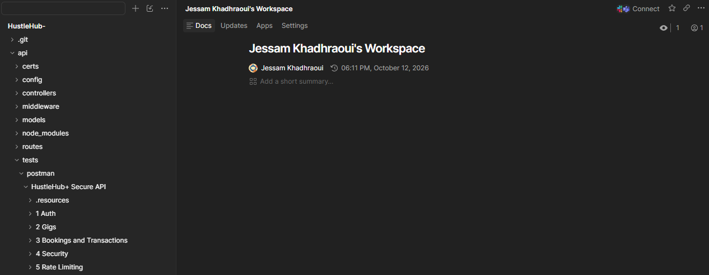 | 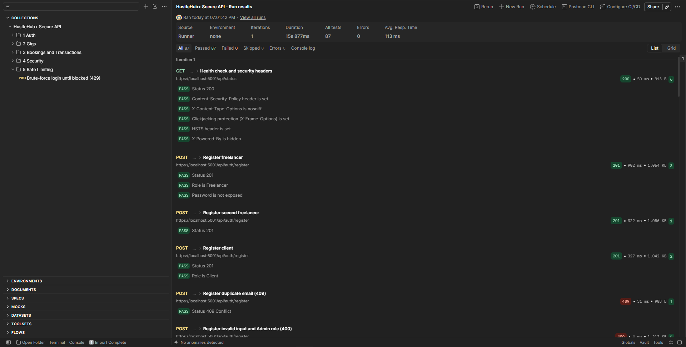 |

| Test run (CLI) | HTML report |
|---|---|
| 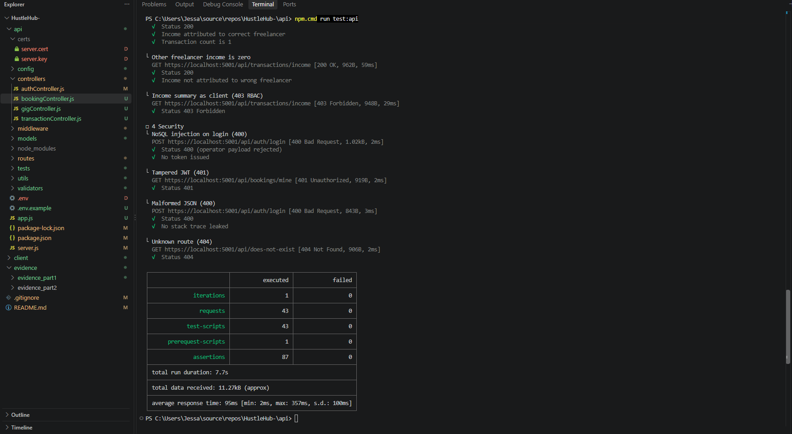 | 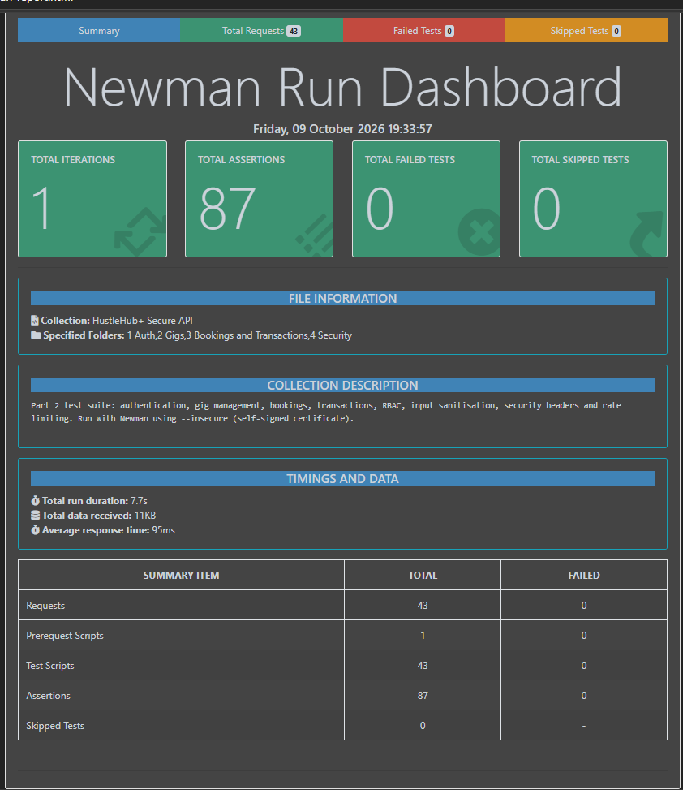 |
| **Rate limiting (429)** | **Rate limiting HTML report** |
| 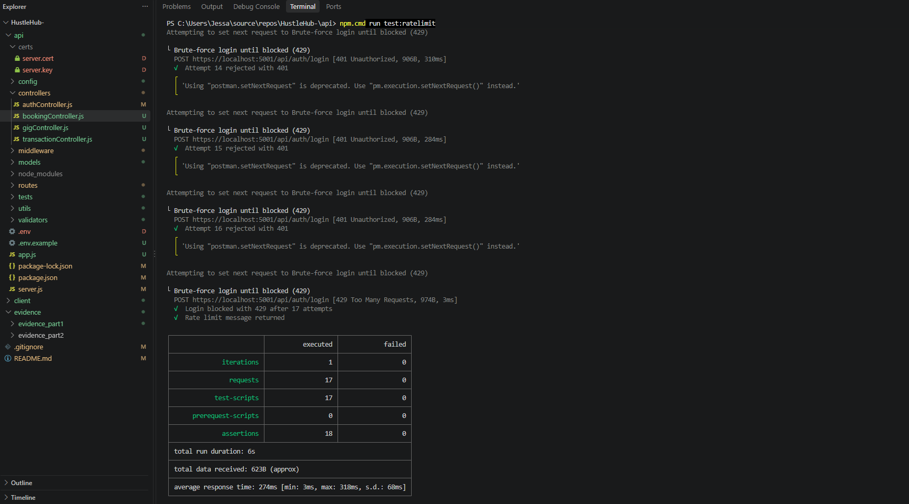 | 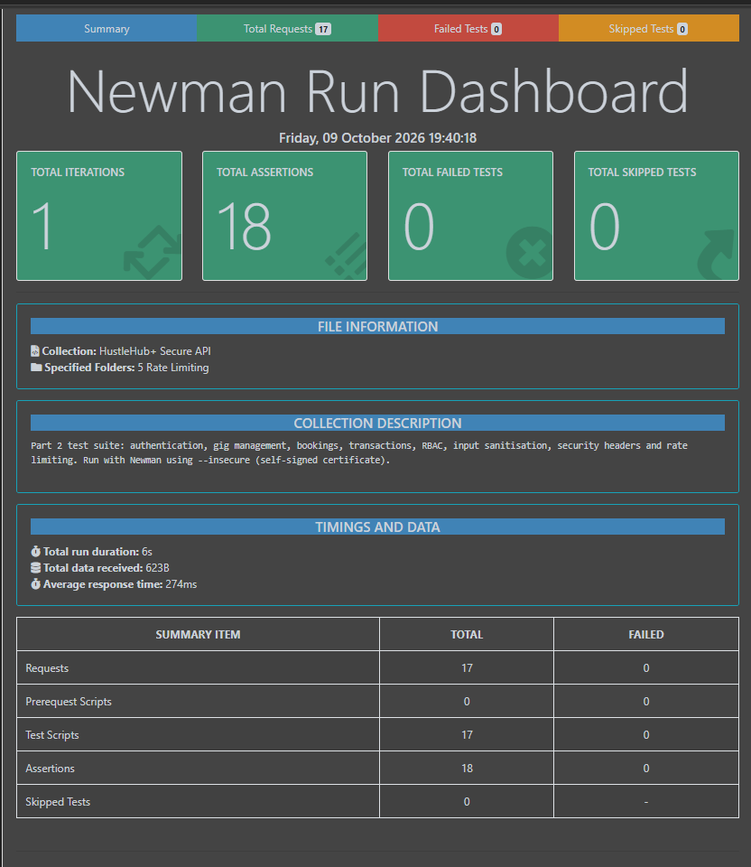 |

**Frontend tests (Vitest)**

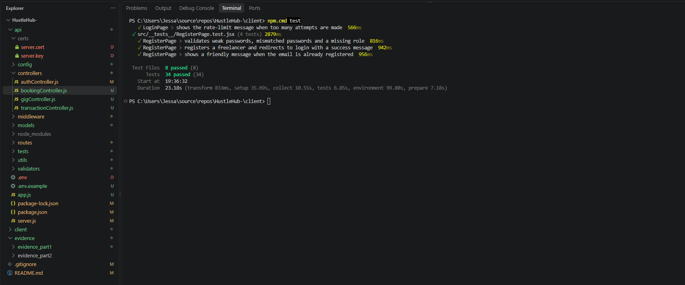

**Application**

| Register | Login | Browse gigs |
|---|---|---|
| 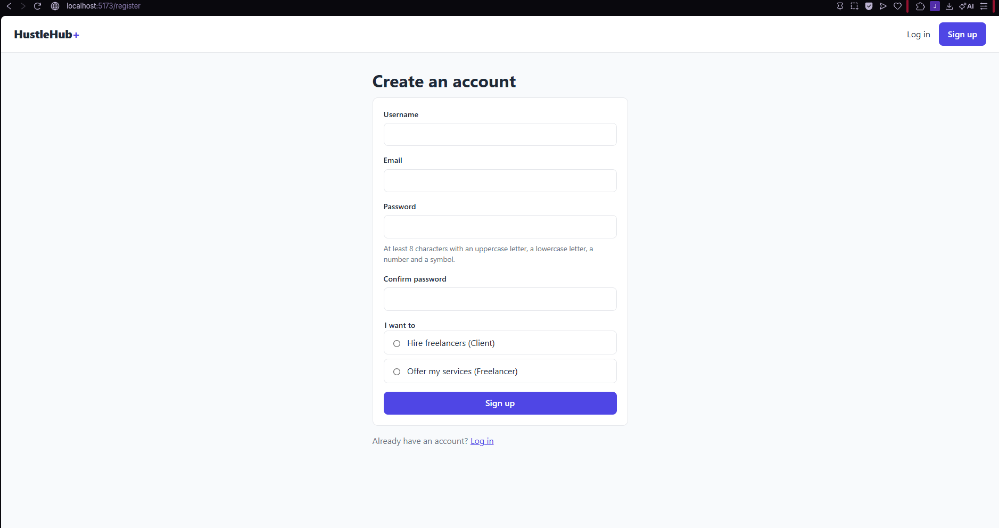 | 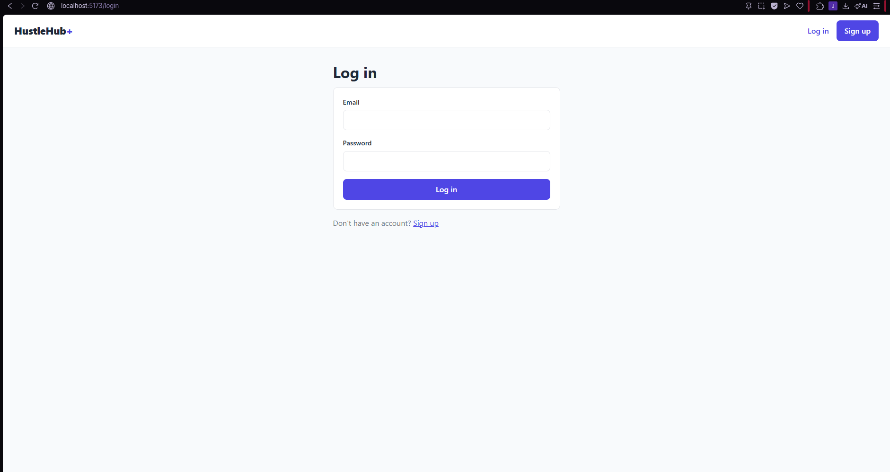 | 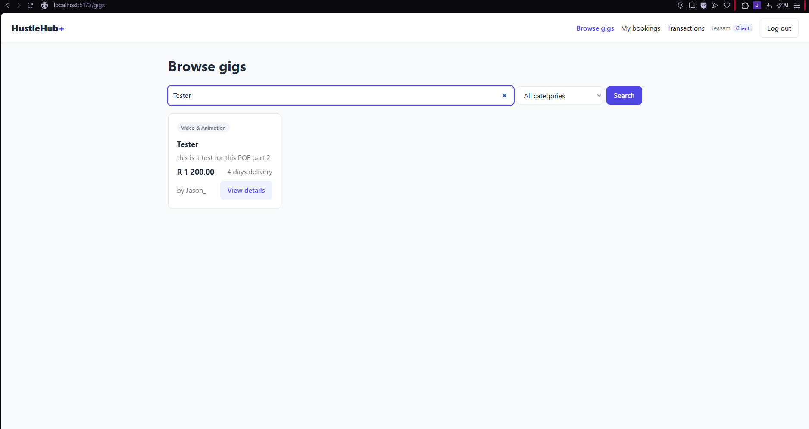 |

| Create gig | Booking (simulated payment) | Booking confirmed |
|---|---|---|
| 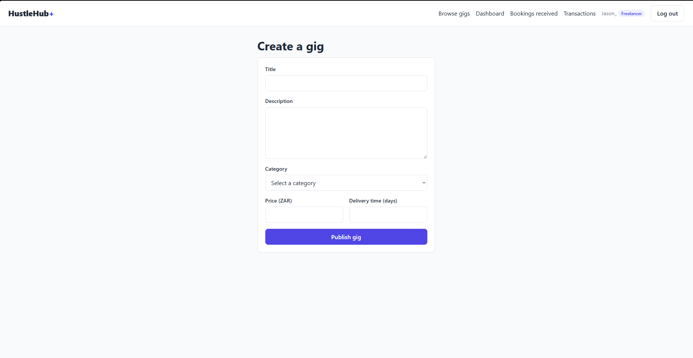 | 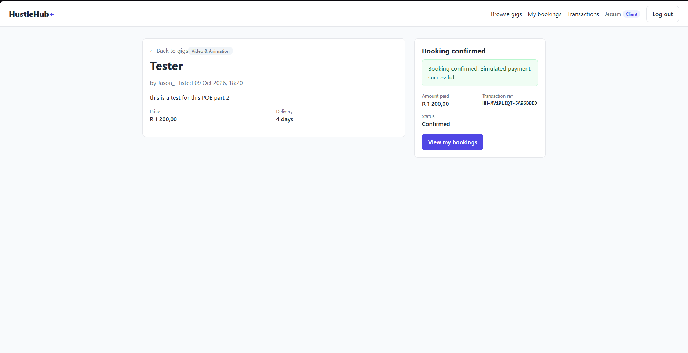 | 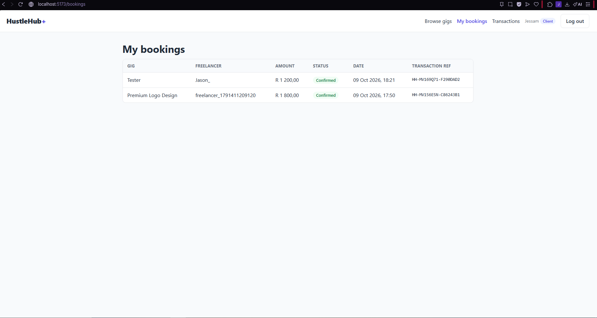 |

| Client bookings | Freelancer dashboard | Access denied (RBAC) |
|---|---|---|
| 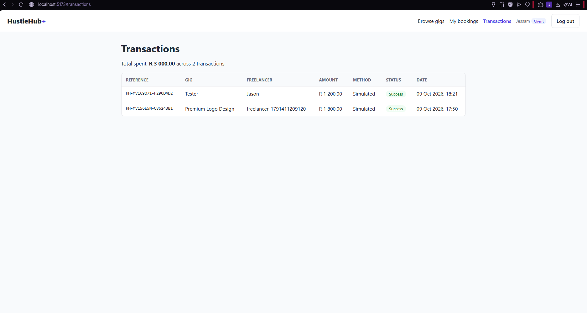 | 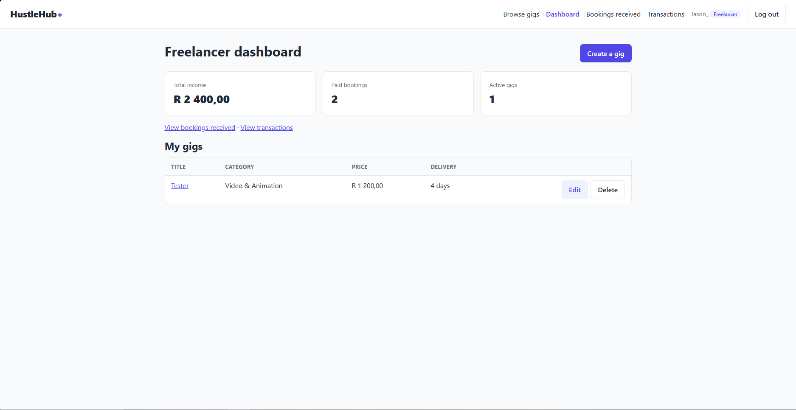 | 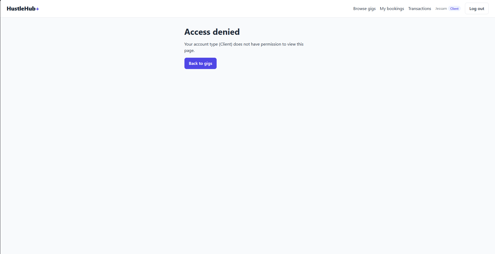 |

### Demonstration video

[Watch the demonstration video](https://youtu.be/3Hc0sNXJRpc)

